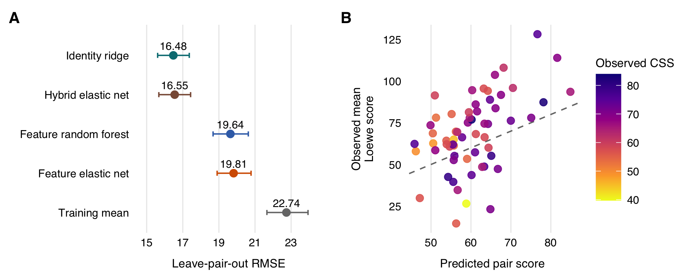

# Drug Combination Prediction: An O'Neil Screen Example

Code and results for the worked example in Section 3.6, *A Practical Workflow for Drug Combination Prediction*. The analysis predicts the Loewe synergy score for new pairings of known drugs in an existing cell line panel. It uses the O'Neil oncology screen and the public DeepSynergy labels and features.

[Project page](https://xnnba1984.github.io/drug-combination-prediction-example/) | [Download code and summary results](https://github.com/xnnba1984/drug-combination-prediction-example/archive/refs/heads/main.zip)

The dataset contains 22,737 unique drug pair-cell line observations, covering 583 pairs, 38 drugs, and 39 cell lines. Five published validation folds keep every observation for a drug pair together. Model tuning uses the remaining four folds.



**Figure 3.1.** (A) Root mean squared error (RMSE) across all out-of-fold predictions. Horizontal lines show 95% confidence intervals from 1,000 bootstrap samples at the drug pair level. (B) The 60 pairs selected from the top 10% within each test fold. Each pair score is the mean prediction for its three highest-ranked cell lines. Observed Loewe scores and combination sensitivity scores (CSS) are averaged over those same cell lines. The dashed line marks equality between predicted and observed scores.

## Results

| Model | RMSE |
| :--- | ---: |
| Training mean | 22.739 |
| Identity ridge | 16.476 |
| Feature elastic net | 19.815 |
| Hybrid elastic net | 16.551 |
| Feature random forest | 19.637 |

The identity ridge model had the lowest RMSE. It uses drug and cell line indicators, with interactions between each drug and cell line. Molecular and gene expression features added little for this endpoint and validation task.

Among the highest-ranked 10% of triplets, 91% had an observed Loewe score above 10, compared with 34.4% overall. The weighted mean enrichment across folds was 2.68. Among the 60 displayed pairs, observed scores exceeded predictions in 43; the mean observed-minus-predicted difference across all 60 was 8.55. CSS is examined after ranking and is excluded from model predictors. These are retrospective results from an existing screen.

## Setup

The reference environment is R 4.6.1 and Python 3.12 on macOS with Apple silicon. Package versions are fixed in `renv.lock` and `requirements.txt`. Run commands from this directory.

Download and extract the repository using the link above, or clone it with Git:

```sh
git clone https://github.com/xnnba1984/drug-combination-prediction-example.git
cd drug-combination-prediction-example
```

Install the analysis dependencies:

```sh
python3.12 -m venv .venv
.venv/bin/python -m pip install -r requirements.txt
Rscript --vanilla setup.R
```

On Windows, use `.venv\Scripts\python.exe` in place of `.venv/bin/python`. The R entry points recognize that location automatically. A different interpreter can be selected through `SECTION3_PYTHON`.

R packages are installed in `.Rlib/`. Some locked versions require compilation. This needs a working R build toolchain, including a Fortran compiler for `glmnet`. On macOS, setup detects an existing Homebrew `gettext` installation when its headers are needed. It does not install system software. See [reproduction details](docs/reproduction.md) for the tested environment and checks.

## Redraw The Figure

```sh
Rscript --vanilla run_figures.R
```

This uses the released summary tables to redraw Figure 3.1 and its two panels in `outputs/figures/`. It takes no raw data and does not fit models.

## Run The Analysis

```sh
.venv/bin/python scripts/acquire_sources.py
Rscript --vanilla run_all.R
```

The first command downloads fixed source versions, checks their hashes, and builds the input tables. The second prepares the analysis data, fits the models, and produces the results. All five folds, the bootstrap intervals, and 20 pair-block permutation checks are rerun. Figure PDFs are saved with nonessential metadata cleared.

Source downloads total about 3.1 GB. Allow at least 8 GB of free disk space; 16 GB of memory is recommended for reading the published feature matrix. Download time depends on the source servers. Full analysis time is reported in `logs/run_all.log`. Random forests use eight threads by default; `SECTION3_THREADS` sets this value.

## Files

| Path | Contents |
| :--- | :--- |
| `R/` | Data preparation, prediction models, evaluation, figures, and checks |
| `scripts/` | Source acquisition, feature extraction, input verification, and PDF cleanup |
| `data/README.md` | Source versions, access links, and redistribution terms |
| `data/input_checksums.json` | Expected hashes for the seven analysis inputs |
| `reference_results/` | Checked summary tables and the chapter figure |
| `docs/methods.md` | Validation, model specifications, and ranking definitions |
| `docs/reproduction.md` | Execution details and interpretation of checks |

Downloads, processed observations, model checkpoints, local package libraries, and run logs are excluded from version control. Full runs create them locally. The public package contains computed summaries and figure-level aggregates. Data access and reuse follow the terms of each original source.

## Sources And Citation

The analysis and code are by Miles Xi. Software citation information is in [CITATION.cff](CITATION.cff). Please also cite the source studies when using their data or methods:

- O'Neil et al. (2016). *An Unbiased Oncology Compound Screen to Identify Novel Combination Strategies.* [Molecular Cancer Therapeutics](https://doi.org/10.1158/1535-7163.MCT-15-0843).
- Preuer et al. (2018). *DeepSynergy: predicting anti-cancer drug synergy with Deep Learning.* [Bioinformatics](https://doi.org/10.1093/bioinformatics/btx806).
- Zheng et al. (2021). *DrugComb update: a more comprehensive drug sensitivity data repository and analysis portal.* [Nucleic Acids Research](https://doi.org/10.1093/nar/gkab438).
- Malyutina et al. (2019). *Drug combination sensitivity scoring facilitates the discovery of synergistic and efficacious drug combinations in cancer.* [PLOS Computational Biology](https://doi.org/10.1371/journal.pcbi.1006752).
- Friedman, Hastie, and Tibshirani (2010). *Regularization Paths for Generalized Linear Models via Coordinate Descent.* [Journal of Statistical Software](https://doi.org/10.18637/jss.v033.i01).
- Wright and Ziegler (2017). *ranger: A Fast Implementation of Random Forests for High Dimensional Data in C++ and R.* [Journal of Statistical Software](https://doi.org/10.18637/jss.v077.i01).

The original analysis code and documentation use the [MIT license](LICENSE). Third-party data and installed dependencies retain their own terms; see [the source notices](THIRD_PARTY_NOTICES.md).
